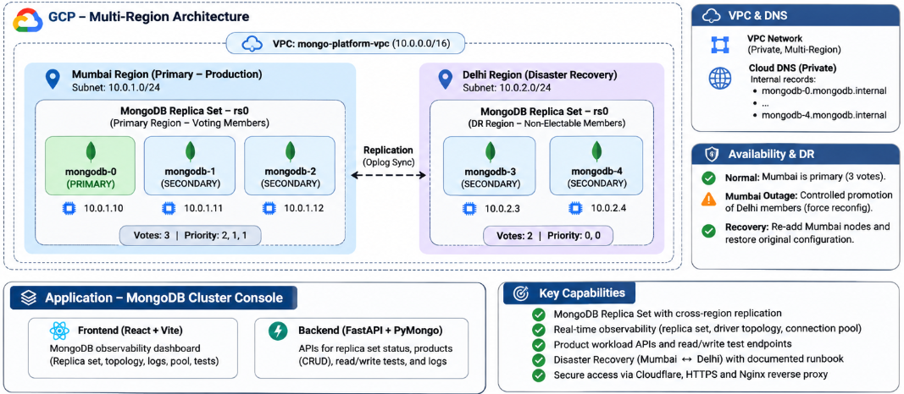

# MongoDB Infrastructure Platform

A hands-on infrastructure project for provisioning, operating, observing, and testing a MongoDB replica set on Google Cloud Platform (GCP), including a cross-region disaster-recovery (DR) environment.

## Architecture overview



The diagram summarizes the public ingress path, the GCP multi-region MongoDB topology, the application components, and the current DR quorum limitation.

> **Topology note:** The five MongoDB members are part of one replica set (`rs0`). Mumbai has three voting members; Delhi has two voting members. If all Mumbai members are unavailable, Delhi cannot independently elect a primary because it does not have the three-vote majority. The documented DR exercise is a controlled, operator-driven procedure, not automatic regional failover.

## Project objectives

- Provision MongoDB infrastructure on GCP.
- Build a replica set across multiple availability zones.
- Configure private DNS and replica-set member authentication.
- Connect an application to MongoDB using PyMongo.
- Observe replica-set health, driver topology, read/write behavior, and connection pools.
- Exercise cross-region DR promotion and recovery.

## Current documented MongoDB topology

| Region | GCP region | Members | Normal role |
|---|---|---|---|
| Mumbai | `asia-south1` | `mongodb-0`, `mongodb-1`, `mongodb-2` | Primary region |
| Delhi | `asia-south2` | `mongodb-3`, `mongodb-4` | DR region |

The current node addresses are documented in the deployment guides. Verify live GCP resources and replica-set configuration before treating this README as an operational source of truth.

## Repository layout

```text
MongoDB-Infrastructure-Platform/
├── README.md
├── docs/
│   ├── images/
│   │   └── architecture-overview.svg
│   ├── architecture.md
│   ├── operations.md
│   └── deployment/
│       ├── 01-vpc-and-network-foundation.md
│       ├── 02-provision-initial-mongodb-vm.md
│       ├── 03-install-and-configure-mongodb.md
│       ├── 04-provision-mumbai-replica-nodes.md
│       ├── 05-configure-private-dns.md
│       ├── 06-replica-set-member-authentication.md
│       ├── 07-initialize-and-validate-replica-set.md
│       ├── 08-application-database-and-connectivity.md
│       ├── 09-mongodb-cross-region-dr-runbook.md
│       └── rs0-original-config.txt
└── MongoDB-Cluster-Console/
    ├── README.md
    ├── backend/
    ├── frontend/
    └── systemd/
```

## Documentation guide

| Document | Purpose |
|---|---|
| `docs/architecture.md` | Detailed infrastructure architecture |
| `docs/operations.md` | Routine operational procedures |
| `docs/deployment/01-vpc-and-network-foundation.md` | GCP VPC and network foundation |
| `docs/deployment/02-provision-initial-mongodb-vm.md` | Initial MongoDB VM provisioning |
| `docs/deployment/03-install-and-configure-mongodb.md` | MongoDB installation and base configuration |
| `docs/deployment/04-provision-mumbai-replica-nodes.md` | Mumbai replica-node provisioning |
| `docs/deployment/05-configure-private-dns.md` | Private DNS configuration |
| `docs/deployment/06-replica-set-member-authentication.md` | Replica-set internal authentication |
| `docs/deployment/07-initialize-and-validate-replica-set.md` | Replica-set initialization and validation |
| `docs/deployment/08-application-database-and-connectivity.md` | Application database and connectivity |
| `docs/deployment/09-mongodb-cross-region-dr-runbook.md` | Cross-region DR and recovery runbook |
| `docs/deployment/rs0-original-config.txt` | Captured original replica-set configuration; review before publishing |

Follow the numbered deployment documents in sequence unless a document says otherwise.

## MongoDB Cluster Console

The separate application contains a React/Vite frontend and FastAPI/PyMongo backend. It provides replica-set status, driver topology, sample product CRUD operations, read/write tests, connection-pool information, and logs.

See [`MongoDB-Cluster-Console/README.md`](MongoDB-Cluster-Console/README.md) for application configuration, manual startup, systemd deployment, Nginx notes, and troubleshooting.

## Public DNS, Cloudflare, and Nginx

The application host uses Cloudflare to manage the public DNS record for `chailearn.rakops.in`. Nginx terminates HTTPS on port `443` and redirects HTTP on port `80` to HTTPS.

The supplied host-level Nginx configuration proxies these paths:

| Public path | Local upstream |
|---|---|
| `/` | `127.0.0.1:3001` |
| `/api/` | `127.0.0.1:3000` |
| `/docker/` | `127.0.0.1:3002/` |
| `/docker/api/` | `127.0.0.1:3003/api/` |

These upstream ports are distinct from the MongoDB Cluster Console's documented development ports (Vite `3000`, FastAPI `8000`). Treat the supplied Nginx configuration as a shared host reverse-proxy configuration; do not assume those routes publish this console without checking the running services.

Cloudflare public DNS is separate from Google Cloud DNS private zone `mongodb.internal.`, which is used for internal MongoDB member discovery.

## Getting started

Cloning this repository does not provision GCP infrastructure automatically.

1. Read `docs/architecture.md`.
2. Follow the numbered guides in `docs/deployment/`.
3. Validate MongoDB replica-set health and private connectivity.
4. Configure and start the console using `MongoDB-Cluster-Console/README.md`.
5. Use `docs/operations.md` for routine procedures and the DR runbook for controlled failure exercises.

## Disaster recovery

The DR runbook documents a controlled exercise: fence Mumbai, promote the Delhi members through a forced reconfiguration, then reconcile and restore Mumbai.

**Safety:** Forced reconfiguration can roll back or lose writes that were not majority committed. Mumbai must be conclusively fenced before Delhi is force-reconfigured. Do not apply the lab procedure to production without a reviewed recovery plan, tested backups, defined RPO/RTO, and tested fencing.

## Security and publication checklist

- Exclude `.env` files, passwords, MongoDB keyfiles, private keys, and service-account credentials from Git.
- Never commit Nginx TLS private-key material.
- Review `docs/deployment/rs0-original-config.txt` for sensitive internal details.
- Consider whether private IPs, internal DNS names, project identifiers, and infrastructure metadata should be removed from a public repository.
- Use a least-privilege MongoDB application user, not the replica-set root/admin account.
- Restrict firewall rules to required source networks and ports.
- Enable MongoDB TLS before using the deployment over untrusted networks.

## Project status

This repository documents a five-member MongoDB replica-set lab across Mumbai and Delhi and a separate application console. Confirm live GCP resources, replica-set configuration, Cloudflare DNS, Nginx upstream services, and application behavior before relying on this README operationally.
